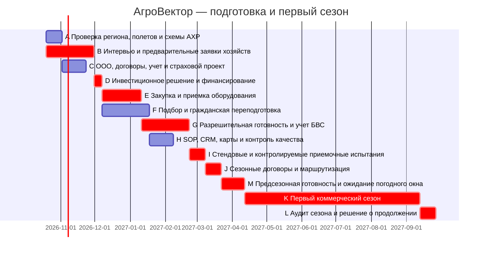
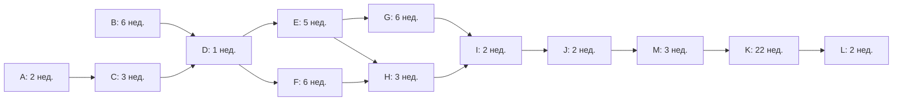

# АгроВектор

## Инвестиционный бизнес-план ранней стадии

Сервис применения сельскохозяйственных дронов для мониторинга посевов и точечного внесения удобрений, средств защиты растений и биопрепаратов.

Редакция 20.10.2026; исходные допущения 05.09.2026 · Плановый горизонт 2027–2031 · Валюта: рубли РФ.

**Статус:** инвестиционная гипотеза до пилота; продажи, разрешения и финансирование не подтверждены. **Рекомендация:** условное поэтапное финансирование, а не безусловная закупка флота.

**Маркировка:** [ФАКТ] — проверенный внешний источник; [РАСЧЕТ] — результат модели; [ДОПУЩЕНИЕ] — проектное решение или еще не подтвержденная гипотеза. Маркер в начале абзаца или перед таблицей распространяется на весь абзац/таблицу, если строка не помечена иначе.

## 1. Резюме

[ДОПУЩЕНИЕ] АгроВектор — мобильный сервис для малых и средних сельхозпредприятий и фермерских хозяйств. Клиент покупает не дрон, а согласованное обследование, карту проблемных зон, точечное внесение жидких удобрений, СЗР, биопрепаратов или энтомофагов и отчет о работе. Агрохолдинги рассматриваются как вторичный сегмент. Полноценное водное орошение исключено: конструкция сервиса ориентирована на малые объемы технологических составов, а не доставку поливной воды.

[ДОПУЩЕНИЕ] Базовый кластер — Татарстан, радиус до 150 км, только после проверки полетной и агрохимической доступности конкретных участков. Одна бригада, основной и резервный агродроны, отдельный мониторинговый аппарат. Первый коммерческий сезон — апрель–сентябрь 2027; подготовка начинается осенью 2026. Контракты, разрешения, поставщики и инвестиции пока не подтверждены.

[ДОПУЩЕНИЕ] Социальная составляющая — добровольная гражданская переподготовка людей с опытом управления БПЛА после СВО для работы в АПК. Общие требования к компетенциям, безопасности и допускам одинаковы для всех сотрудников; прежний опыт не заменяет профессиональную подготовку.

[РАСЧЕТ] Ключевые показатели условного базового сценария:

| Показатель | Значение |
| --- | --- |
| Начальная потребность | 9 500 000 руб. |
| CAPEX / запуск / ликвидность | 7 000 000 / 500 000 / 2 000 000 руб. |
| Выручка 2027 / EBITDA2027 | 8 800 000 / 1 960 000 руб. |
| NPV за 5 лет, ставка 24% | 3 946 443 руб. |
| Простая / дисконтированная окупаемость | 2,68 / 3,88 года |

[ДОПУЩЕНИЕ] Рекомендация инвестору — условное поэтапное финансирование. Не закупать весь парк без юридического заключения по региону, подтверждения кадрового бюджета и коммерческого портфеля. Положительная NPV не компенсирует отсутствие права на работы. Мониторинг без внесения не объявляется равноценной финансовой заменой: такой вариант требует отдельной малокапитальной модели.

## 2. SMART-цели

[ДОПУЩЕНИЕ] SMART-цели первого сезона. Даты являются контрольным планом, а не подтверждением выполненных работ. При пропуске правовой или закупочной контрольной точки календарь пересматривается до финансирования.

| Цель | Измеримый результат | Срок | Ответственный и доказательство |
| --- | --- | --- | --- |
| Правовая применимость | Осуществимость разрешительного маршрута по полям; не выданное разрешение | 01.11.2026 | Директор; письменное заключение юриста |
| Подтверждение спроса | 20 интервью; заявки на 6 000 га-проходов и 4 000 га-обследований | 29.11.2026 | Директор; реестр полей и заявок, без объявления их продажами |
| Коммерческий портфель | 10 клиентов; суммарно 6 000 га-проходов и 4 000 га-обследований | 21.03.2027 | Директор; подписанные договоры и календарь |
| Техническая готовность | Приняты 3 аппарата; 2 оператора прошли оценку; пилот 100 га внутри сезонного объема | 30.04.2027 | Операционный руководитель; до 11.04 — приемка и допуски, в апреле — акт пилота |
| Первый сезон | 6 000 га-проходов, 4 000 га-обследований; выручка 8,8 млн руб. без НДС | 12.09.2027 | Директор; акты, журнал операций, бухгалтерский учет |
| Гражданская подготовка | 2 оператора: индивидуальный план, наставник и оценка; контроль занятости через 3 месяца | 11.04.2027; контроль 12.07.2027 | Операционный руководитель; протоколы обучения и кадровый учет |

Обучение добровольное; квоты по биографическому статусу нет. Самостоятельные работы допускаются только после оценки компетенций. Безопасность: 100% заданий проходят проверку готовности; все опасные события регистрируются. Цель — ноль работ без необходимых допусков, а не обещание отсутствия любого инцидента.

## 3. Описание продукта и стратегическая канва

[ДОПУЩЕНИЕ] Продукт — договорная услуга мониторинга посевов, картирования проблемных зон и точечного внесения на согласованных участках. Клиент покупает выполненное задание и отчет, не дрон. Препараты предоставляет клиент; культуру, регламент применения и карту задания проверяет внешний агроном. Универсальный рост урожайности и экономия препаратов не обещаются. Выпуск энтомофагов допускается только при подтвержденной технологии и правовом статусе, не как третья строка выручки. Полноценное орошение исключено.

### Стратегическая канва предложения

[ДОПУЩЕНИЕ] Целевой профиль: локальный маршрут в Татарстане до 150 км, минимум внесения 100 га-проходов, один договор на согласованные операции и отчет не позднее 48 часов после задания. Это гипотеза позиционирования, не достигнутое преимущество. Факторы выбора клиента — цена, состав, доступность поля, минимальный маршрут, срок и проверяемость отчета. Единственная сравнительная матрица этих факторов приведена в разделе 6; повторная таблица здесь не создается.

[ДОПУЩЕНИЕ] Подготовка полетного задания, согласование границ и отчет об исполнении входят в тариф внесения. Отдельное обследование с картированием продается за 250 руб./га-обследование по самостоятельной строке заказа; один договор не означает бесплатного мониторинга или повторного счета одних работ. Минимальный отдельный заказ мониторинга пока не установлен: до приема такого выезда проверяются маршрут и его вклад в покрытие затрат. Новые доплаты не включены в расчетную выручку. Паспорт заказа содержит поле, культуру, операции, кратность, окно, цену, приемку и статус допуска.

## 4. Business Model Canvas

[ДОПУЩЕНИЕ] Business Model Canvas фиксирует проверяемые гипотезы раннего проекта. До подтверждения договоров указанные сегменты и партнерства не считаются сформированным рынком сбыта.

| Блок | Содержание модели | Проверка гипотезы |
|---|---|---|
| 1. Потребительские сегменты | КФХ и малые/средние хозяйства Татарстана — основной сегмент; агрохолдинги — вторичный; руководитель покупает, агроном принимает результат | Интервью по конкретным полям, культурам и календарям |
| 2. Ценностное предложение | Мониторинг, карта задания, подходящее точечное внесение и отчет в одном договорном контуре | Платный пилот, согласованные критерии приемки |
| 3. Каналы | Прямые продажи директора, рекомендации агрономов, демонстрации на согласованных площадках | Стоимость привлечения и переход заявки в договор |
| 4. Отношения с клиентами | Персональное планирование сезона, единый контакт, уведомления о переносах, разбор отклонений | Продление договора и реестр претензий |
| 5. Потоки доходов | Оплата внесения за га-проход; отдельная оплата согласованного мониторинга за га-обследование | Акты, отсутствие повторного выставления одного объема |
| 6. Ключевые ресурсы | Одна бригада, основной и резервный аппараты внесения, мониторинговый аппарат, транспорт, документы и оборотный резерв | Приемка, ресурсный календарь и кассовый план |
| 7. Ключевые действия | Продажи, правовая проверка, планирование, подготовка задания, безопасное исполнение, обслуживание и отчетность | Регламенты, журналы и контроль качества |
| 8. Ключевые партнеры | Внешний агроном, учебный партнер, сервис техники, юрист, бухгалтер; поставщики препаратов взаимодействуют с клиентом | Договоры, квалификация, сроки реакции |
| 9. Структура затрат | OPEX: труд, логистика, обслуживание, специалисты, страхование, маркетинг, IT и учет; CAPEX и запуск отдельно; резерв ликвидности не является расходом | Сметы, предложения поставщиков, ежемесячный план-факт |

[ДОПУЩЕНИЕ] Выпуск энтомофагов относится к согласованной операции внесения, а не формирует третью строку выручки. Повторный проход учитывается только при отдельном задании и фактическом выполнении. Площадь мониторинга может совпадать с обработанными полями; это разные услуги, но не дополнительные уникальные гектары территории.

[ДОПУЩЕНИЕ] Все партнеры — кандидаты до подписания договоров; ресурсы — план закупки до внесения капитала. Два потока доходов и три FTE соответствуют финансовому плану. Резерв 2 млн руб. — ресурс покрытия кассового разрыва, а не себестоимость услуги.

## 5. Маркетинговый план

[ДОПУЩЕНИЕ] Приоритет — КФХ и малые/средние сельхозпредприятия с фрагментированными полями, культурами высокой ценности, переувлажненными участками и недостаточной собственной техникой. Покупатель — руководитель хозяйства; технический заказчик и приемщик — агроном. Агрохолдинги — вторичный сегмент для пиков нагрузки и сложных участков, а не якорь первого сезона.

### TAM SAM SOM и проверка расчета

Рынок проекта — платные услуги агродронов по внесению и мониторингу для КФХ и малых/средних хозяйств. Оценка — годовая, в ценах 2027 года, без НДС, препаратов клиента и продажи дронов. TAM — потенциальный спрос выбранного сегмента РФ; SAM — его доступная часть в кластере Татарстана до 150 км; SOM — объем, который одна бригада планирует продать и выполнить в первом сезоне. SAM вложен в TAM. Доступность требует проверки конкретного поля.

[ДОПУЩЕНИЕ] База 2000 хозяйств РФ и 200 хозяйств кластера, средняя площадь 2000 га, пригодность 15%, 1,5 прохода внесения и 0,5 обследования на пригодный гектар — параметры сценария. Список хозяйств и пригодность не подтверждены. Поэтому эти результаты называются сценарной емкостью выбранного сегмента, а не установленной емкостью всей России. До адресного реестра точность 1,245 млрд руб. арифметическая, а не статистическая.

[РАСЧЕТ] Пригодная площадь = число хозяйств × средняя площадь × доля пригодности. Внесение = пригодная площадь × 1,5; мониторинг = пригодная площадь × 0,5. Емкость = внесение × 1300 + мониторинг × 250.

| Уровень | Хозяйства | Пригодная площадь, га | Внесение, га-проходы | Мониторинг, га-обследования | Емкость, руб./год |
|---|---:|---:|---:|---:|---:|
| TAM выбранного сегмента, сценарий | 2000 | 600000 | 900000 | 300000 | 1245000000 |
| SAM кластера, сценарий | 200 | 60000 | 90000 | 30000 | 124500000 |
| SOM сезона 2027, цель | 10 | Не суммируется по услугам | 6000 | 4000 | 8800000 |

[РАСЧЕТ] TAM = 2000 × 2000 × 0,15 × (1,5 × 1300 + 0,5 × 250). SAM использует ту же формулу для 200 хозяйств. SOM = 6000 × 1300 + 4000 × 250 = 7,8 млн + 1,0 млн = 8,8 млн руб. Средние 600 га-проходов на каждого из 10 клиентов относятся к внесению; 400 га-обследований на клиента — отдельная целевая услуга, если все 10 заказывают мониторинг.

| Доля SOM в SAM | Расчет | Результат |
|---|---|---:|
| По внесению | 6000 / 90000 × 100% | 6,67% |
| По мониторингу | 4000 / 30000 × 100% | 13,33% |
| По выручке двух услуг | 8800000 / 124500000 × 100% | 7,07% |

Основной SOM: 6 000 га-проходов и 4 000 га-обследований. Отношение обследований к проходам 0,667 против 0,333 в SAM. Дополнительный спрос на мониторинг подтверждается отдельно; поэтому денежная доля 7,07% не равна доле по внесению 6,67%.

### Альтернативный микс — не базовая выручка

При среднем миксе SAM мониторинг составил бы 2 000 обследований, выручка — 8,3 млн руб., денежная доля — 6,67%. Это отдельный тест гипотезы, не замена 8,8 млн в финансовой базе. Снижение мониторинга на 2 000 обследований уменьшает денежный вклад 2027 после УСН на 350 000 руб. при неизменных фиксированных расходах.

[РАСЧЕТ] Ограничение мощности: 6000 / 130 + 4000 / 500 = 54,15 полевых дня при плановых производительностях проекта. Это ниже потолка 120 дней, однако пики агрономических окон, погода, транспорт и отдых могут ограничить загрузку. SOM проверяется одновременно по договорам, кадрам и календарю. Резервный борт не создает вторую бригаду.

### Чувствительность сценарной емкости

При прежних числе хозяйств, площади, частоте и тарифах меняется только пригодность. Диапазон не является доверительным интервалом.

| Пригодность | TAM, руб./год | SAM, руб./год | Цель SOM / SAM |
|---|---:|---:|---:|
| 10% | 830000000 | 83000000 | 10,60% |
| 15%, база | 1245000000 | 124500000 | 7,07% |
| 20% | 1660000000 | 166000000 | 5,30% |

Для подтверждения оценки нужны адресный список хозяйств, площадь и культуры по каждому клиенту, агрономически подходящие операции, доступность участков, частота заказов и готовность оплатить тариф. Национальная площадь обработок не подменяет выручку подрядчиков и не служит знаменателем региональных долей.

### Выход на рынок

[ДОПУЩЕНИЕ] Каналы: прямые продажи через агрономов, партнеры по биопрепаратам и удобрениям, фермерские объединения, демонстрации на поле и рекомендации. Плановая воронка: 100 адресных контактов → 40 квалифицированных разговоров → 20 квалифицированных предложений → 10 сезонных клиентов. Ни одно соглашение пока не подписано. Предварительное интервью не считается продажей.

[ДОПУЩЕНИЕ] Годовой маркетинговый бюджет 240000 руб. входит в постоянный OPEX. Денежный CAC при 10 новых клиентах — 24000 руб. без распределения зарплаты директора; это не fully-loaded CAC. Средняя выручка на клиента в первом сезоне — 880000 руб. при условном распределении всех услуг между десятью клиентами. Агрономические консультации, дорога в согласованном радиусе и отчет включены; дальний выезд и малый участок требуют отдельной сметы и не заложены как дополнительная выручка.

[ДОПУЩЕНИЕ] Коммерческие условия: минимальный планируемый маршрут 100 га-проходов, 30% аванс, остаток после акта; модель ликвидности консервативно не опирается на аванс. Ценность проверяется на сопоставимых контрольных участках: сроки, площадь, качество покрытия, повреждение колеи, расход состава. Процент экономии СЗР и прирост урожая до испытаний не обещаются.

[ДОПУЩЕНИЕ] Контроль спроса: если к решению о закупке нет подтвержденного доступного портфеля на 6000 га-проходов, капиталоемкий запуск переносится; допускается отдельный малый пилот через законного оператора. Его экономика не подменяет базовую модель собственной бригады.

### Наблюдаемая отрасль и динамика

[ФАКТ] Министр сельского хозяйства сообщила об около 600 тыс.га полей, обработанных агродронами в 2025 году.[8] РСХБ в публикации 16.07.2026 приводит 781 тыс.га за 2025 год и прогноз 1058 тыс.га на 2026 год.[9]

[ДОПУЩЕНИЕ] Источники расходятся по 2025 году; охват и правила учета проходов недостаточно раскрыты. Их нельзя объединять в один ряд или выдавать прогноз 2026 за выполненные работы. Сопоставимый первичный национальный итог 2024 не подтвержден. Площади включают не только внешние платные услуги, поэтому умножение отраслевой площади на наш тариф не является доказанным объемом сервисного рынка. Приведенный выше TAM — сценарная будущая корзина, а не текущая платная выручка отрасли.

[РАСЧЕТ] Внутри оценки РСХБ прогнозный рост 2026 к 2025 составляет 35,47% (1058/781−1), но этот темп не переносится на финансовую модель АгроВектора: ее выручку определяют собственные гектары, тариф и мощность. Плановый средний CAC24000 руб. и выручка 880000 руб. на клиента рассчитаны как 240000/10 и 8800000/10 соответственно.

[ДОПУЩЕНИЕ] Основная база — 6 000 га-проходов и 4 000 га-обследований, 8,8 млн руб. Альтернативные 8,3 млн — только тест среднего микса SAM, а не исправленная выручка базы. Требуются отдельные заявки на мониторинг; его спрос нельзя выводить из числа проходов внесения.

[ДОПУЩЕНИЕ] Двадцать интервью SMART — исследование спроса; двадцать предложений воронки — отдельная стадия, не автоматическое следствие интервью. Заявки должны раскрывать клиентов, культуры, контуры полей, обе услуги, кратность, цену и агрономическое окно. Предварительная заявка не равна обязательному договору. Подтвержденных заказов нет.

## 6. Анализ конкурентов

[ФАКТ] На 20.10.2026 изучены публичные предложения пяти компаний из единого реестра. Это заявления поставщиков, не независимая проверка качества, разрешений или выполненных работ. Дата публикации страниц не раскрыта, если прямо не указано иное. BeeUAV проверен по странице услуги; главная осталась недоступной, ее прежний адрес и условия не объявляются перепроверенными. У каждой строки ниже указаны источник и дата; ссылки раскрыты в реестре источников.

| Исполнитель / статус | Услуги, территория и цена | Комплект, маршрут и отчетность | Опыт, доля и доказательства |
| --- | --- | --- | --- |
| BeeAir / BeeUAV; [ФАКТ] заявление компании; региональный кандидат | Услуги: внесение. Территория: Татарстан упомянут на сервисной странице; наличие местной базы не подтверждено. Цена: числовая цена на прочитанной странице не раскрыта. НДС: не раскрыт. | Комплект: состав единого пакета мониторинга и внесения не раскрыт. Минимум/маршрут: не раскрыт. Отчет: состав и срок отчета не раскрыты. | Опыт/объем: годовые гектары не раскрыты; рекламные 10 и 18 га/ч на одной странице несогласованы. Доля: публично не раскрыта; нет сопоставимого числителя и знаменателя. [2] Проверено: 2026-10-20. Публикация: не указана. сервисная страница прочитана; главная недоступна; прежний адрес МО не подтвержден заново. |
| ГК Агропрофи / XAG; [ФАКТ] заявление компании; региональный кандидат | Услуги: внесение; посев; продажа техники отдельно от услуги. Территория: Поволжье включая Татарстан; контакт Саратов. Цена: публичный тариф услуги не раскрыт. НДС: для услуги не раскрыт. | Комплект: опрыскивание; разбрасывание; посев; агрономическое сопровождение заявлено. Минимум/маршрут: не раскрыт. Отчет: формат и срок клиентского отчета не раскрыты. | Опыт/объем: заявлено 50 000+ га без года и территории; не годовой объем Татарстана. Доля: публично не раскрыта; накопленные гектары не доля рынка. [3][4] Проверено: 2026-10-20. Публикация: не указана. страницы прочитаны напрямую; объемы являются заявлениями поставщика. |
| Аграс / аграс.рф; [ФАКТ] заявление компании; региональный кандидат | Услуги: аренда пилота/техники; демонстрация; продажа и сервис отдельно. Территория: Татарстан и Урал заявлены; локальный офис Татарстана не проверен по адресу. Цена: публичный тариф услуги не раскрыт. НДС: НДС продажи техники не подтверждает НДС услуги. | Комплект: комплект техники и обучения не приравнен к составу подрядной услуги. Минимум/маршрут: не раскрыт. Отчет: отчетность при внедрении не равна спецификации отчета по обработке. | Опыт/объем: по заявлению компании проекты Татарстана 2025: более 40 000 га; исполнитель и оплаченный объем не раскрыты. Доля: публично не раскрыта; нет сопоставимого знаменателя услуг. [5] Проверено: 2026-10-20. Публикация: не указана; акция до октября 2026. главная прочитана; разрешения и внедрения по реестрам не подтверждены. |
| Гермес; [ФАКТ] заявление компании; межрегиональный ориентир | Услуги: внесение; мониторинг виноградников; посев. Территория: Краснодарский край и Адыгея; Татарстан не подтвержден. Цена: публичный тариф услуги не раскрыт. НДС: не раскрыт. | Комплект: направления заявлены; единый договорный пакет не раскрыт. Минимум/маршрут: не раскрыт. Отчет: формат и срок отчета не раскрыты. | Опыт/объем: кейс картофельного поля 500 га без даты и актов; годовой объем не раскрыт. Доля: публично не раскрыта; кейс не годовая доля. [6] Проверено: 2026-10-20. Публикация: не указана. главная прочитана извлекателем; счетчики 0 не интерпретированы как отсутствие работ. |
| Агродроны ЮФО; [ФАКТ] заявление компании; межрегиональный ориентир | Услуги: внесение; обработка полей; посев. Территория: Калмыкия; Дагестан; Ставрополье; Краснодарский край; Ростовская область; контакт Элиста. Цена: 900 руб./га; средняя заявленная руб./га; итог индивидуально; эквивалентность га-проходу и логистика не установлены. НДС: не раскрыт. | Комплект: препараты клиента; помощь в подборе; состав воды и логистики уточняется. Минимум/маршрут: минимум не раскрыт; начало 1–7 дней по загрузке и согласованию. Отчет: акты; сертификаты; закрывающие документы; срок и GIS-отчет не раскрыты. | Опыт/объем: заявлены парк и производительность; годовые оплаченные гектары не раскрыты. Доля: публично не раскрыта; производительность не выполненный объем. [7] Проверено: 2026-10-20. Публикация: не указана. главная прочитана напрямую; география сохранена списком а не названием федерального округа. |
| АгроВектор; [ДОПУЩЕНИЕ]; проект | Услуги: внесение; мониторинг и картирование. Территория: Татарстан до 150 км от базы только при подтвержденном допуске. Цена: план 2027: 1300 руб./га-проход; отдельно 250 руб./га-обследование; препараты клиента. НДС: без НДС; добавляется при обязанности. | Комплект: единый договор; подготовка задания и отчет во внесении; обследование оплачивается отдельно. Минимум/маршрут: план от 100 га-проходов; минимум отдельного мониторинга не установлен. Отчет: план: объем и параметры задания; отклонения; акт; отчет до 48 часов. | Опыт/объем: сезон не проведен; 6000 проходов и 4000 обследований цель а не фактический объем. Доля: фактическая доля не установлена; SOM/SAM только сценарий раздела 5.  Проверено: 2026-10-20. Публикация: план 2027. проектные параметры не рыночная оферта; нет подтвержденных контрактов и разрешений. |

[ДОПУЩЕНИЕ] Географически релевантные кандидаты для сопоставимых КП — BeeUAV, Агропрофи и Аграс. Последний теперь прямо заявляет Татарстан, поэтому больше не описывается только как уральский ориентир.[2][3][5] Гермес и ЮФО — межрегиональные ориентиры; доступность в Татарстане не подтверждена.[6][7] Производитель XAG не является отдельным исполнителем услуги. Наземный подрядчик и собственный опрыскиватель хозяйства — заменители: их сравнивают по полной смете конкретного задания.

[ФАКТ] ЮФО публикует средние 900 руб./га с индивидуальным расчетом, препараты клиента и закрывающие документы; НДС, минимальный заказ и логистика не раскрыты.[7] [РАСЧЕТ] Проектные 1300 руб. выше этого ориентира на 44,44%, но различия региона, единицы и состава не позволяют объявить это измеренной рыночной премией. Стресс 900 руб. дает отрицательную NPV в разделе 18.

[ДОПУЩЕНИЕ] Доли конкурентов в сопоставимом рынке платных услуг Татарстана публично не раскрыты. Для процента нужны год, территория, услуги, оплаченный объем или выручка участника и такой же знаменатель рынка. 50 000+ га Агропрофи без года и территории и >40 000 га проектов Аграс за 2025 год не дают долю сервисного рынка.[3][5] Неизвестное не равно нулю. SOM/SAM проекта — сценарное отношение раздела 5, не фактическая доля. До закупки нужны минимум три сопоставимых предложения на услуги для одного поля и отдельно два КП на полный парк техники; не смешивать эти два требования.

## 7. Развернутый SWOT

[ДОПУЩЕНИЕ] SWOT отражает внутреннюю конструкцию проекта и сценарии внешней среды, а не доказанные преимущества действующей компании.

| Группа | Фактор | Коммерческое последствие | Управленческое действие |
|---|---|---|---|
| S | Связка мониторинга, задания и отчета | Возможность продавать понятный результат | Единый паспорт заказа и критерии приемки |
| S | Резервный аппарат внесения | Снижение зависимости от единичного отказа | Проверять готовность резерва перед выездом |
| S | Компактная команда | Короткая цепочка согласования | Закрепить полномочия остановки работ |
| W | Отсутствие подтвержденного портфеля | Риск недозагрузки после закупки | Условное инвестиционное решение после проверки заявок |
| W | Одна бригада и совмещение ролей | Конфликты сроков и зависимость от людей | Единый календарь, ограничение принимаемых обязательств |
| W | Экономный фонд труда | Риск вакансий, текучести и перегрузки | Проверить предложения кандидатам до закупок |
| O | Неудовлетворенные локальные задачи клиентов | Возможность повторных заказов | Проверять проблему на конкретном поле |
| O | Гражданская переподготовка кандидатов с опытом БПЛА | Потенциальный кадровый канал | Добровольный отбор и обучение на равных условиях |
| T | Ограничения полетов и технологий | Невозможность исполнения части договоров | Юридический стоп-фактор и прозрачные условия переноса |
| T | Несовпадение погоды и агрономических окон | Потеря объемов без технической поломки | Приоритеты заданий, запас времени, отказ от перегруза |
| T | Ценовое давление или задержка оплаты | Снижение маржи и кассовый разрыв | Авансирование, проверка дебиторской задолженности |

[ДОПУЩЕНИЕ] SO-стратегия — тестировать комплексное предложение на локальных задачах; WO — закрывать дефицит компетенций наставником и внешним агрономом. ST — использовать отчетность и технический резерв для управляемого исполнения. WT — не расширять парк и географию до подтверждения юридической доступности, кадров и фактической экономики сезона.

[ДОПУЩЕНИЕ] Владельцы стратегий: директор проверяет спрос и тариф до D; операционный руководитель проверяет общий риск основного/резервного борта до G; агроном согласует применимость до каждого выезда. Совместимость АКБ, зарядок и сервиса может создавать общий отказ обоих бортов.

## 8. Пять сил Портера

[ДОПУЩЕНИЕ] Пять сил Портера оцениваются сценарно; уровни не являются результатом измерения регионального рынка.

| Сила | Уровень гипотезы | Механизм воздействия | Ответ проекта | Что проверить |
|---|---|---|---|---|
| Конкуренция действующих исполнителей | Высокий | Сравнение тарифов и свободных окон | Продавать определенное задание, сроки и приемку | Сопоставимые предложения по одинаковому полю |
| Угроза новых участников | Средний | Появление дополнительной услуги у действующих подрядчиков | Развивать повторные договоры и дисциплину качества | Реальные сроки запуска и стоимость готовности |
| Угроза заменителей | Высокий | Наземная обработка, собственная техника, отказ от операции | Отбирать задачи, где клиент видит ценность сервиса | Полная стоимость и применимость альтернатив |
| Власть покупателей | Высокий | Сезонный торг и концентрация заказов | Разделять объемы по клиентам, фиксировать условия заранее | Концентрацию портфеля и причины отказов |
| Власть поставщиков | Средний–высокий | Зависимость от техники, аккумуляторов и ремонта | Резервный аппарат, запас критичных деталей, сервисный договор | Совместимость, гарантийные условия, сроки ремонта |

[ДОПУЩЕНИЕ] Гипотеза зависит от повторного спроса и исполнения в сезонном окне. Устойчивое преимущество до полевой проверки не подтверждено.

[ДОПУЩЕНИЕ] Барьеры входа включают капитал, подготовку людей, ремонт и разрешительную процедуру. Эти же барьеры ограничивают AgroVector, поэтому не считаются уже полученной защитой от новых игроков.

## 9. Организационно-правовая форма и регуляторный контур

[ДОПУЩЕНИЕ] Предпочтительная форма — ООО для долевого участия инвестора и договорной ответственности. ОКВЭД, УСН, корпоративные условия и страхование утверждаются с профильными специалистами. Этот раздел — исследовательская карта требований, не юридическое заключение и не разрешение на полеты.

[ФАКТ] 20.10.2026 прочитана официальная карточка Указа Республики Татарстан от 25.11.2022 № УП-813 «Об использовании беспилотных воздушных судов на территории Республики Татарстан», опубликованного 30.11.2022.[32] Полный действующий текст исключений и основание допуска AgroVector не подтверждены. Радиус 150 км — логистическое допущение, не разрешенная полетная зона.

[ФАКТ] При повторном чтении вторичного правового текста ФАП по приказу Минтранса №303 подтверждены вступление с 01.09.2026, сертификат, эксплуатационная спецификация и требования к организации работ.[17] Официальный скан [16] сейчас заново содержательно не прочитан; действует обязательная сверка первоисточника и актуальной редакции до инвестирования. Реквизиты не подменяют проверку применимости.

[ДОПУЩЕНИЕ] Для каждой выбранной модели устанавливается максимальная взлетная масса по документам, не пустой вес или объем бака. Прежняя правовая основа учета 0,15–30 кг включительно и регистрации более 30 кг сохранена как датированный снимок статьи 33 ВК РФ.[15] До допуска требуется свежая проверка учета/регистрации, летной годности, эксплуатанта, персонала, спецификации работ, страхования, воздушного пространства и региональных ограничений. Договор с фермером, малая высота и частная земля сами по себе не разрешают полет; участие AgroVector в ЭПР не подтверждено.

[ФАКТ] В актуально прочитанном разъяснении территориального Россельхознадзора о правилах с 01.03.2026 обычное уведомление о пестицидах проводится не ранее 10 и не позднее 5 календарных дней, через СМИ и ФГИС «Сатурн»; указан радиус до 7 км и специальный порядок не позднее 24 часов только при установленном уровне реагирования и режиме ЧС.[31] Обычный срочный заказ или перенос из-за ветра не объявляется чрезвычайной ситуацией.

[ДОПУЩЕНИЕ] Агроном проверяет актуальный госреестр и регламент каждого препарата: культуру, вредный объект, способ применения, норму раствора, дозу, кратность, ожидание и экологические ограничения. Препараты клиента не снимают ответственности исполнителя. Ни один препарат проекта не утвержден; уменьшение нормы рабочего раствора не разрешается ссылкой на обычную авиационную обработку. В договоре назначаются ответственные за уведомления, «Сатурн», остатки, тару, мойку, отходы и журнал.

### Санитарный и региональный контроль допуска

[ДОПУЩЕНИЕ] Архив 05.09.2026 содержит выдержки о 700 м в отдельных поправках СанПиН.[18][19] Реквизиты введения СП 2.2.4285-26 с 01.09.2026 сохранены в официальной карточке и вторичном тексте прежнего снимка.[20][21] Пункты 287/291 о наземной альтернативе и остановке при людях/животных в пределах 2000 м прочитаны ранее в неофициальной копии.[27] На 20.10.2026 полный официальный скан построчно не сверен. Эти числа не объявляются универсальными действующими нормами для любого БАС: письменная правовая проверка соотношения специальных положений обязательна. Радиус уведомления пчеловодов 7 км не заменяет санитарные расстояния.

[ДОПУЩЕНИЕ] Контроль A устанавливает осуществимость разрешительного маршрута, а не выдает допуск; G проверяет документы конкретного борта, оператора и работ; M и каждый выезд повторно проверяют ограничения. Нет письменного основания, подходящего препарата или безопасного поля — остановка без замены права на работы коммерческой целью. Стратегия развития БАС остается отраслевым контекстом, не гарантией субсидии и не разрешением компании.[26] Гранты в модель не включены. Статус каждого старого источника 16–28 приведен в исследовании C и реестре источников.

## 10. Стейкхолдеры: власть и интерес

[ДОПУЩЕНИЕ] Матрица власти и интереса используется для распределения коммуникаций. Высокая власть означает способность остановить финансирование, разрешение либо исполнение заказа, а не особый статус участника.

| Стейкхолдер | Власть / интерес | Ожидание или конфликт | Взаимодействие | Ответственный |
|---|---|---|---|---|
| Учредитель | Высокая / высокий | Сохранение капитала и управляемость | Еженедельный контроль запуска, месячный план-факт | Директор |
| Долевой инвестор | Высокая / высокий | Прозрачность расходов и условий участия | Отчетность, согласование крупных решений | Директор |
| Клиенты и их агрономы | Высокая / высокий | Соблюдение окна, качество, понятная приемка | Паспорт поля, календарь, отчет, разбор претензий | Директор и операционный руководитель |
| Уполномоченные органы | Высокая / переменный | Соблюдение применимых требований | Документы и согласования по конкретной территории | Внешний юрист |
| Операторы | Средняя / высокий | Безопасность, оплата, реалистичная нагрузка | Инструктаж, обратная связь, право остановки | Операционный руководитель |
| Кандидаты после СВО | Низкая / высокий | Добровольный переход в гражданскую профессию | Конфиденциальный отбор, наставник, ясные требования | Директор |
| Учебный партнер и агроном | Средняя / высокий | Корректные задания и границы ответственности | Программа обучения, проверка знаний, согласование карт | Операционный руководитель |
| Сервис оборудования | Средняя / средний | Оплата и планируемое обслуживание | Регламент ремонтов, сроки реакции | Операционный руководитель |
| Соседи полей и местное сообщество | Низкая / переменный | Отсутствие недопустимого воздействия | Канал обращений, предусмотренное уведомление | Директор |

[ДОПУЩЕНИЕ] Социальная коммуникация не раскрывает персональную историю сотрудников без согласия и не обещает привилегированного допуска к полетам. Жалобы на безопасность рассматриваются независимо от коммерческой ценности заказа.

[ДОПУЩЕНИЕ] Пчеловоды и владельцы соседних участков — отдельная группа с высоким интересом к безопасности: директор обеспечивает предусмотренные уведомления и канал жалоб; агроном проверяет ограничения. Жалоба или выявление угрозы может остановить работу независимо от формальной власти заявителя. Страховщик согласует покрытие и порядок сообщения об инциденте до допуска G.

## 11. Производственный план

[ДОПУЩЕНИЕ] Производственный контур включает одну бригаду из двух операторов, два аппарата внесения — основной и резервный — и один мониторинговый. Резерв восстанавливает доступность при отказе основного, но не удваивает производительность. Полный цикл заказа: проверка применимости и разрешений → обследование и согласование задания → подготовка техники и материалов клиента → выполнение → контроль и актирование.

[ДОПУЩЕНИЕ] Сезон длится 22 недели. Плановая емкость внесения опирается на 100 эффективных рабочих дней с производительностью 130 га-проходов в день. Это интегральная гипотеза с учетом переездов и подготовки, которую необходимо подтвердить хронометражем. Календарные недели не означают ежедневную летную доступность.

[РАСЧЕТ] 22 недели = 154 календарных дня. В пятом году внесение требует 100 × 130 = 13 000 га-проходов, мониторинг — 20 × 500 = 10 000 га-обследований. Последовательное выполнение занимает 120 полевых рабочих дней; остаются 34 дня погодного и логистического резерва. [ДОПУЩЕНИЕ] Это напряженный потолок, а не гарантированная мощность: производительность мониторинга 500 га в день и достаточность резерва требуют проверки.

| Год | Внесение, га-проходы | Мониторинг, га-обследования |
|---|---:|---:|
| 2027 | 6000 | 4000 |
| 2028 | 9000 | 6000 |
| 2029 | 11000 | 8000 |
| 2030 | 12000 | 9000 |
| 2031 | 13000 | 10000 |

[ДОПУЩЕНИЕ] Мониторинг проводится помощником в отдельных согласованных окнах при сохранении необходимых условий безопасности. Одновременные полеты внесения и мониторинга без отдельной команды недопустимы. Обработка данных переносится в нелетное время; совокупный календарь обеих услуг проверяется до подтверждения заказа. Объемы последних лет являются целями, а не доказательством наличия трудового ресурса.

[ДОПУЩЕНИЕ] Тарифы 2027 года без НДС: 1300 руб. за га-проход внесения и 250 руб. за га-обследование. Препараты клиента не включены. Полевой пилот 100 га проводится в апреле 2027 года внутри 6000 га-проходов первого сезона и не прибавляется повторно. Перед выездом проверяются документы, погода, состояние техники, пригодность материала и согласованный контур. При отклонении задание приостанавливается; повторная работа оформляется по условиям договора, а не автоматически как новая выручка.

[РАСЧЕТ] Проверка совместной мощности:22×7=154 календарных дня; внесение 13000/130=100 дней, мониторинг 10000/500=20 дней, резерв 34 дня. [ДОПУЩЕНИЕ] Производительность мониторинга 500 га/день и 120 полевых дней — напряженный потолок, а не гарантия; работы выполняются последовательно, выходные и нормы отдыха соблюдаются. Полевой пилот 100 га в апреле включен в 6000 га-проходов первого сезона. При невозможности подтвердить такой календарь объемыY4–Y5 снижаются.

[ДОПУЩЕНИЕ] Приемочный хронометраж включает полный маршрут, подготовку, смешивание, АКБ/зарядку, мойку и отчет; рекламные га/час не заменяют га за полную смену. Календарь должен включать отдых, погодные паузы, уведомления и обслуживание. Поздний годовой объем пока является ресурсно не подтвержденным верхним сценарием, не обязательством клиентам.

[РАСЧЕТ] При одинаковой сезонности обеих услуг июнь 2031 требует 30 полевых дней из 30 календарных. Годовые 120 дней не доказывают выполнимость месяца: отдых, погода и обслуживание не обеспечены. [ДОПУЩЕНИЕ] Поздние объемы сохранены только как непроверенный верхний сценарий. До обязательств клиентам нужен ресурсный календарь; при неподтверждении снижаются объемы или оценивается дополнительный оплачиваемый ресурс с пересчетом всей модели. Машинный ресурсный экран: data/capacity_check.csv; 5 дней из 7 — условная проверка, не юридический режим труда.

[ДОПУЩЕНИЕ] Отдельный ресурсный стресс ограничивает одну бригаду 20 эффективными полевыми днями в каждом месяце. Это не наблюденная погода и не подтверждение производительности. Требуемые дни: (га-проходы / 130 + га-обследования / 500) × доля месяца. При превышении 20 оба месячных объема сокращаются одинаковым коэффициентом 20 / требуемые дни; невыполненные работы не переносятся. Постоянные расходы, замены и возврат резерва сохранены.

[РАСЧЕТ] NPV ресурсного стресса — 2 309 588,02 руб.; простая / дисконтированная окупаемость — 2,758 / 4,259 года. Базовая модель не заменена. Помесячные объемы и годовые потоки: data/capacity_scenario_monthly.csv и data/capacity_scenario_annual.csv; формулы — scripts/build_capacity_scenario.py.

[ДОПУЩЕНИЕ] Базовые 4 млн руб. на основной и резервный аппараты внесения не подтверждены КП. Ориентир пары XAG P100 Pro — 5,98 млн руб.; закупочный стресс требует 11,48 млн руб. финансирования. Проверка комплектации и производительности обязательна; подробности в разделе 17.

## 12. Организационный план

[ДОПУЩЕНИЕ] Штат — 3 FTE: директор, совмещающий продажи и управление финансами; оператор — операционный руководитель; второй оператор, выполняющий также функции помощника. Внешние агроном, юрист и бухгалтер привлекаются по договорам и включаются в бюджет отдельно от штатного фонда труда. Наименования «Продажи» и «Операционный руководитель» в проектных таблицах обозначают функции, а не дополнительные вакансии.

| Роль | Основные обязанности | Ограничение полномочий |
|---|---|---|
| Директор / продажи | Клиенты, договоры, деньги, партнеры, персонал | Не отменяет профессиональный запрет на выполнение |
| Оператор / операционный руководитель | Календарь, техника, безопасность, наставничество | Не заменяет агронома и юридическую проверку |
| Второй оператор / помощник | Подготовка, контроль, мониторинг в отдельных окнах | Самостоятельные действия только после проверки компетенций |
| Внешний агроном | Задания, технологическая применимость, качество | Не предоставляет автоматического разрешения на полеты |
| Внешние юрист и бухгалтер | Правовая готовность, учет, договорные и налоговые вопросы | Работают в согласованном объеме услуг |

[ДОПУЩЕНИЕ] Полная стоимость штатного труда принята на уровне 3 млн руб. в год. Это экономный и рискованный бюджет, требующий проверки начислений, условий кандидатов и сезонной нагрузки; рост обязательных выплат нельзя скрывать за неоплачиваемыми переработками.

[ДОПУЩЕНИЕ] Людям с опытом БПЛА после СВО предлагается добровольная гражданская переподготовка: оценка исходных навыков, обучение агротехнологии и безопасности, работа с наставником, практическая проверка и документированное решение о готовности. Требования одинаковы для всех кандидатов; прежний опыт не означает автоматического допуска. При необходимости предусматривается индивидуальный темп адаптации и добровольное обращение за поддержкой без раскрытия чувствительных данных клиентам.

## 13. WBS / иерархическая структура работ

[ДОПУЩЕНИЕ] WBS формируется из единого набора работ в `scripts/build_plan.py`; табличное представление — `data/project_plan.csv`. Иерархия охватывает проверку модели, финансирование и подготовку ресурсов, предсезонную готовность, коммерческий сезон и итоговый аудит. Каждый пакет имеет проверяемый результат, а не только факт затраченного времени.

[ДОПУЩЕНИЕ] Отдельный пакет M предусматривает три недели предсезонной готовности и ожидания погодного окна после J. Приемочные испытания I не подменяются зимней коммерческой обработкой; полевой пилот выполняется в K и включается в апрельский сезон. Закупка не разрешает автоматически начинать работы: необходима готовность по G и контроль перед конкретным выездом.

| WBS | ID | Работа | Результат |
| --- | --- | --- | --- |
| 1.1 | A | Проверка региона, полетов и схемы АХР | Осуществимость разрешительного маршрута; не выданное разрешение |
| 1.2 | B | Интервью и предварительные заявки хозяйств | 20 интервью; заявки на 6000 га-проходов и 4000 га-обследований |
| 1.3 | C | ООО, договоры, учет и страховой проект | ООО; договоры; страховые предложения |
| 2.1 | D | Инвестиционное решение и финансирование | Условия траншей и лимит необратимых расходов; 9,5 млн только для базы; КП и обязательства клиентов проверяются до закупки |
| 2.2 | E | Закупка и приемка оборудования | Комплектность; серийные номера; акты |
| 2.3 | F | Подбор и гражданская переподготовка | Два оператора; экзамен и допуск |
| 2.4 | G | Разрешительная готовность и учет БВС | Документы на конкретные БВС/работы; либо no-go |
| 3.1 | H | SOP, CRM, карты и контроль качества | Чек-листы; шаблон отчета; аварийный план |
| 3.2 | I | Стендовые и контролируемые приемочные испытания | Акт стендовой приемки; полевой пилот отдельно в K до 30.04.2027 |
| 3.3 | J | Сезонные договоры и маршрутизация | 10 клиентов; согласованный календарь |
| 3.4 | M | Предсезонная готовность и ожидание погодного окна | Повторная проверка разрешений и погодного окна |
| 4.1 | K | Первый коммерческий сезон | 6000 га-проходов; 4000 га-обследований |
| 4.2 | L | Аудит сезона и решение о продолжении | Факт P&L/ДДС; претензии; продления |

## 14. Диаграмма Ганта

[ДОПУЩЕНИЕ] Диаграмма Ганта должна строиться из того же набора задач, длительностей и зависимостей, что WBS и сетевой график. Базовый старт коммерческого сезона — 12 апреля 2027 года после трехнедельного пакета M; продолжительность сезона K — 22 недели. Это плановый ориентир, а не гарантия летной доступности.

[ДОПУЩЕНИЕ] Параллельность подготовки не означает возможность параллельной загрузки одной бригады в поле. Директор проверяет доступность исполнителей; переносы отражаются в едином календаре и согласуются с клиентами.

[РАСЧЕТ] Календарь в календарных неделях; связи окончание–начало. Перепланирование от 2026-10-19; прежние сентябрьские даты не означают выполненные работы. Даты — целевой план, не выданные разрешения. При задержке критического пути коммерческое окно и денежная модель пересматриваются.

| ID | Начало | Окончание | Недели | Резерв, нед. |
| --- | --- | --- | --- | --- |
| A | 2026-10-19 | 2026-11-01 | 2 | 1 |
| B | 2026-10-19 | 2026-11-29 | 6 | 0 |
| C | 2026-11-02 | 2026-11-22 | 3 | 1 |
| D | 2026-11-30 | 2026-12-06 | 1 | 0 |
| E | 2026-12-07 | 2027-01-10 | 5 | 0 |
| F | 2026-12-07 | 2027-01-17 | 6 | 2 |
| G | 2027-01-11 | 2027-02-21 | 6 | 0 |
| H | 2027-01-18 | 2027-02-07 | 3 | 2 |
| I | 2027-02-22 | 2027-03-07 | 2 | 0 |
| J | 2027-03-08 | 2027-03-21 | 2 | 0 |
| M | 2027-03-22 | 2027-04-11 | 3 | 0 |
| K | 2027-04-12 | 2027-09-12 | 22 | 0 |
| L | 2027-09-13 | 2027-09-26 | 2 | 0 |

[ДОПУЩЕНИЕ] Контрольные точки внутри сезона, без добавления объема или параллельной бригады:

| ID | Дата | Работа | Результат | Ответственный |
| --- | --- | --- | --- | --- |
| PILOT | 2027-04-30 | K | Пилот 100 га внутри 6000; акт и хронометраж | Операционный руководитель |
| RETENTION | 2027-07-12 | K | Контроль занятости и адаптации после подготовки | Директор |

## 15. Сетевой график

[ДОПУЩЕНИЕ] Сетевая модель использует зависимости «окончание–начало» и длительности в календарных неделях из `scripts/build_plan.py`. Ранние и поздние сроки, резервы и критический путь рассчитываются по единому набору задач; независимо заданные даты в текст не вводятся.

[ДОПУЩЕНИЕ] Связь начала сезона проходит через J → M → K. Пакет M является явной работой ожидания и повторной проверки готовности, а не свободным резервом, который можно автоматически расходовать на задержки. Критический путь не гарантирует разрешений или подходящей погоды.

[РАСЧЕТ] Критический путь: **B → D → E → G → I → J → M → K → L**. Продолжительность 49 недель, включая погодный буфер M и первый сезон K. Это плановый CPM, не прогноз срока выдачи документов.

| ID | Предшественники | ES | EF | LS | LF | Резерв |
| --- | --- | --- | --- | --- | --- | --- |
| A | — | 0 | 2 | 1 | 3 | 1 |
| B | — | 0 | 6 | 0 | 6 | 0 |
| C | A | 2 | 5 | 3 | 6 | 1 |
| D | B;C | 6 | 7 | 6 | 7 | 0 |
| E | D | 7 | 12 | 7 | 12 | 0 |
| F | D | 7 | 13 | 9 | 15 | 2 |
| G | E | 12 | 18 | 12 | 18 | 0 |
| H | E;F | 13 | 16 | 15 | 18 | 2 |
| I | G;H | 18 | 20 | 18 | 20 | 0 |
| J | I | 20 | 22 | 20 | 22 | 0 |
| M | J | 22 | 25 | 22 | 25 | 0 |
| K | M | 25 | 47 | 25 | 47 | 0 |
| L | K | 47 | 49 | 47 | 49 | 0 |

## 16. Матрица ответственности RACI

[ДОПУЩЕНИЕ] RACI переносится из единого проектного набора: R — исполнитель, A — ответственный за результат, C — консультируемый, I — информируемый. Для каждой работы сохраняется один A; делегирование исполнения не снимает ответственности за приемку.

[ДОПУЩЕНИЕ] «Продажи» выполняет директор, «Операционный руководитель» — один из двух операторов. Внешний агроном, юрист, бухгалтер и учебный партнер не увеличивают штат до дополнительных FTE, но требуют оплачиваемого времени. Ответственность инвестора за решение о финансировании не означает оперативного руководства полетами. Матрица должна сопровождаться проверкой нагрузки совмещаемых ролей.

| ID | R — выполняет | A — принимает | C — консультирует | I — информируется |
| --- | --- | --- | --- | --- |
| A | Юрист | Директор | Агроном;Операционный руководитель | Инвестор |
| B | Продажи | Директор | Агроном | Инвестор |
| C | Юрист | Директор | Бухгалтер | Инвестор |
| D | Директор | Инвестор | Бухгалтер;Юрист | Команда |
| E | Операционный руководитель | Директор | Агроном | Бухгалтер |
| F | Операционный руководитель | Директор | Учебный партнер;Агроном | Инвестор |
| G | Юрист | Директор | Операционный руководитель | Клиенты |
| H | Агроном | Операционный руководитель | Юрист | Продажи |
| I | Оператор | Операционный руководитель | Агроном;Клиент | Директор |
| J | Продажи | Директор | Агроном;Клиент | Бухгалтер |
| M | Операционный руководитель | Директор | Агроном;Клиент | Инвестор |
| K | Оператор | Операционный руководитель | Агроном;Клиент | Директор |
| L | Бухгалтер | Директор | Агроном;Операционный руководитель | Инвестор |

## 17. Финансовая модель

[ДОПУЩЕНИЕ] Модель — номинальные рубли РФ,2027–2031, одна бригада, без долга и субсидий. Цены2027 без НДС: внесение1300 руб./га-проход, мониторинг250 руб./га-обследование. Рост цен4% в год, переменных и фиксированных затрат5%; рост загрузки не означает приобретения второй бригады. Препараты и энтомофаги предоставляет клиент; их стоимость отсутствует и в выручке, и в расходах. Все закупочные бюджеты — полная цена с невозмещаемыми налогами у российского поставщика; прямой импорт в базу не включен.

### CAPEX, OPEX и единичная экономика

[ДОПУЩЕНИЕ] CAPEX7млн: два аппарата внесения с АКБ/зарядкой4млн; авто и прицеп1,4млн; мониторинговый аппарат0,6млн; смешивание и безопасность0,4млн; IT0,2млн; капитальный запас заменяемых узлов0,4млн. Последний не является запасом расходных химикатов. Конкретные модели выбираются после проверки максимальной взлетной массы и законной эксплуатации; бюджет не равен подтвержденному предложению поставщика.

[ДОПУЩЕНИЕ] Переменные внесения400руб./га-проход: топливо/логистика150, энергия50, текущее обслуживание130, СИЗ/мойка/обращение с отходами70. Мониторинг60руб./га-обследование: логистика30, энергия/обслуживание20, переменная обработка данных10. Штатная зарплата и амортизация в эти ставки не включены; АКБ и капитальные узлы финансируются CAPEX замен, а не повторно в текущем ремонте.

[ДОПУЩЕНИЕ] Постоянный OPEX2027 — 4,2млнруб.: штат с начислениями3млн; аренда360тыс.; страхование/комплаенс300тыс. (страхование120, юрист60, внешний агроном120); маркетинг240тыс.; IT120тыс.; администрирование180тыс. (бухгалтер120, банк/прочее60). Бюджеты внешних специалистов и труда экономные; подтверждение их достаточности является инвестиционным gate. Стартовые500тыс. распределены на первоначальное обучение200, подготовку правового/операционного досье200 и организационные расходы100; ежегодное сопровождение не дублирует эти разовые работы.

[РАСЧЕТ]

| Услуга2027 | Тариф | Переменные | Вклад до УСН | УСН6% | Вклад после УСН |
| --- | --- | --- | --- | --- | --- |
| Внесение, руб./га-проход | 1300 | 400 | 900 | 78 | 822 |
| Мониторинг, руб./га-обследование | 250 | 60 | 190 | 15 | 175 |

[РАСЧЕТ] Вклад до постоянных затрат2027:6,16млнруб., маржинальность70%. После УСН вклад5,632млн. EBITDA-безубыточность при постоянном миксе услуг:6млнруб. выручки; денежная операционная безубыточность после УСН — 6 562 500руб., или одновременно 4 474,4га-проходов и 2 983,0га-обследований. Это пропорциональный набор услуг, не два независимых порога. CAPEX и возврат инвестиций этим порогом не покрываются.

### Налоги и денежный поток

[ДОПУЩЕНИЕ] Налоговый бюджет основан на архивных чтениях ФНС и закона 04.07.2026 №228-ФЗ: 2027–2029 порог 20 млн, 2030 — 15 млн, 2031 — 10 млн руб.; УСН 6%.[14][12][11] На 20.10.2026 налоговые первоисточники повторно недоступны; это сохраненные параметры модели до новой правовой сверки, не подтверждение актуального налогового режима.

[ДОПУЩЕНИЕ] УСН в модели6% выручки без снижения на страховые взносы — консервативный бюджет, а не выбор оптимального налогообложения. При утрате освобождения применяется5% НДС сверх тарифа при сохранении законных условий специальной ставки, без вычета входного НДС; общая ставка и вычеты требуют отдельного сопоставления с бухгалтером.[28]

[РАСЧЕТ] НДС рассчитывается отдельно: проверяется доход прошлого года и месячное превышение текущего порога с началом обложения со следующего месяца. В базе2027–2029 НДС отсутствует, с2030 начисляется5% сверх выручки из-за превышения доходом2029 порога15млн. Собранный налог полностью перечисляется, не входит в выручку/EBITDA/УСН/FCF. Денежные сроки уплаты упрощены; право переложить налог на клиента должно быть закреплено в договоре.

[ДОПУЩЕНИЕ] Амортизация начальных7млн линейно5лет; замен —3года с года покупки. CAPEX замен2027–2031:0 /300000 /600000 /900000 /600000руб. в номинале. Возмещение входного НДС не финансирует инвестиции. Остаточная стоимость оборудования в денежном потоке равна нулю.

[РАСЧЕТ] Выручка=объем×тариф по каждой услуге; EBITDA=выручка−переменные−фиксированныйOPEX; EBIT=EBITDA−амортизация; расчетная чистая прибыль=EBIT−УСН. FCF=EBITDA−УСН−CAPEXзамен+возвратрезерва. УСН платится с доходов даже при убытке. Амортизация не вычитается из FCF повторно.

[РАСЧЕТ] Все суммы таблицы — рубли, без округления исходных формул:

| Год | Выручка | Переменные | Фикс.OPEX | EBITDA | Амортизация | УСН | Чистая прибыль | CAPEX замен | FCF |
| --- | --- | --- | --- | --- | --- | --- | --- | --- | --- |
| 2027 | 8 800 000,00 | 2 640 000,00 | 4 200 000,00 | 1 960 000,00 | 1 400 000,00 | 528 000,00 | 32 000,00 | 0,00 | 1 432 000,00 |
| 2028 | 13 728 000,00 | 4 158 000,00 | 4 410 000,00 | 5 160 000,00 | 1 500 000,00 | 823 680,00 | 2 836 320,00 | 300 000,00 | 4 036 320,00 |
| 2029 | 17 630 080,00 | 5 380 200,00 | 4 630 500,00 | 7 619 380,00 | 1 700 000,00 | 1 057 804,80 | 4 861 575,20 | 600 000,00 | 5 961 575,20 |
| 2030 | 20 078 822,40 | 6 181 717,50 | 4 862 025,00 | 9 035 079,90 | 2 000 000,00 | 1 204 729,34 | 5 830 350,56 | 900 000,00 | 6 930 350,56 |
| 2031 | 22 695 256,06 | 7 049 936,25 | 5 105 126,25 | 10 540 193,56 | 2 100 000,00 | 1 361 715,36 | 7 078 478,20 | 600 000,00 | 10 578 478,20 |

### Ликвидность и сезонность

[ДОПУЩЕНИЕ] Поступления и выполнение распределены апрель–сентябрь10/20/25/20/15/10%. Услуги оплачиваются в месяц выполнения; плановый договорный аванс30% не используется для улучшения модели. Фиксированные расходы350000руб./месяц. Подготовительные расходы2026 свернуты в t0; годовая модель оценивается на условную дату31.12.2026, не заменяет календарь траншей осени2026.

[РАСЧЕТ] После оплаты оборудования и запуска на счете2млнруб. Минимум месячного остатка2027 — 950 000руб., конец года — 3 432 000руб. Без поступлений резерв покрывает 5,71месяца постоянных расходов. Отдельная таблица: `data/monthly_cashflow_2027.csv`; отсутствие месячного минуса не исключает внутримесячного разрыва.

[ДОПУЩЕНИЕ] Резерв 2 млн учитывается только в t0 и возвращается в конце 2031 при завершении оценочного проекта. Рост дебиторской задолженности не смоделирован; резерв не индексируется. Для продолжающегося бизнеса его возврат исключается. Инвестиционный NPV не является суммой дивидендов инвестору.

### Проверка закупочного бюджета

[ДОПУЩЕНИЕ] Базовые 4 млн руб. на два аппарата внесения — закупочный лимит без выбранной модели, не подтвержденная цена. Производительность 130 га/день подтверждается приемочным испытанием выбранного комплекта, а не характеристиками другой модели.

[ФАКТ] При прямом чтении 20.10.2026 Агропрофи публикует XAG P100 Pro за 2 990 000 руб. за комплект: https://xag-ap.ru/ .[3][29] Состав, налоги, доставка и условия требуют письменного КП. Это ориентир, не договор или решение о выборе модели.

[РАСЧЕТ] Два комплекта стоят 5 980 000 руб., превышение базового лимита — 1 980 000 руб. При прочих равных CAPEX — 8 980 000 руб., финансирование — 11 480 000 руб., NPV — 1 966 443 руб. Это изолированный тест удорожания закупки, не новая полноценная база. Обучение и сопровождение в комплекте нужно исключить из повторного счета после получения КП.

[ДОПУЩЕНИЕ] До инвестирования нужны два сопоставимых КП с АКБ, зарядкой, доставкой, обучением, сервисом и налогами. Необходимо либо подтвердить комплект в лимите 4 млн руб. с нужной выработкой, либо пересчитать модель, финансирование и сроки целиком. Без этого закупочный этап не утверждается.

[ФАКТ] Дилер указывает бак 60 л, официальный производитель XAG — Rated Capacity 50 L.[29][30] Извлекатель дополнительно вернул иную версию карточки (2,9 млн / 50 л), тогда как прямой HTML подтвердил 2,99 млн / 60 л. Ни одна версия не является подтвержденным КП. До закупки нужны артикул, год выпуска, серийная спецификация и полный перечень АКБ, зарядок, охлаждения, RTK, генератора, модулей, налогов и доставки. Состав примера P150 Pro нельзя переносить на P100 Pro.

### Стресс отсрочки оплаты

[ДОПУЩЕНИЕ] Авансов нет; выполнение и переменные по базовому сезону, поступления сдвинуты на полные месяцы; УСН резервируется при поступлении. Годовой результат может скрывать внутрисезонный разрыв.

[РАСЧЕТ]

| Отсрочка, мес. | Минимум денег, руб. | Дополнительная ликвидность, руб. |
| --- | --- | --- |
| 1 | 285 200 | 0 |
| 2 | -724 800 | 724 800 |
| 3 | -1 602 800 | 1 602 800 |

[ДОПУЩЕНИЕ] Нужен календарь платежей октября 2026 — апреля 2027 с траншами, авансами и возвратностью. Он пока не подтвержден; условный t0 не выдается за реальный график оплаты. Резерв не уменьшается повторным вычитанием уже профинансированного CAPEX.

## 18. NPV и окупаемость

[ДОПУЩЕНИЕ] Ставка дисконтирования 24% — требуемая доходность проектного капитала, не рыночная котировка WACC; финансирование долевое. Потоки номинальные, конец каждого года, t0=-9500000 руб. Ликвидационная стоимость оборудования 0; возврат оборотного резерва 2 млн только в конце Y5.

[РАСЧЕТ] NPV=−9500000+Σ(FCFₜ/1,24ᵗ)=3 946 443,10 руб. Простая окупаемость 2,676 года; дисконтированная 3,885 года. Доля года — условная интерполяция, а не точная дата при сезонном потоке.

| Период | FCF, руб. | Коэффициент | PV, руб. | Накопленный PV |
| --- | --- | --- | --- | --- |
| 0 | -9 500 000,00 | 1,000000 | -9 500 000,00 | -9 500 000,00 |
| 1 | 1 432 000,00 | 0,806452 | 1 154 838,71 | -8 345 161,29 |
| 2 | 4 036 320,00 | 0,650364 | 2 625 078,04 | -5 720 083,25 |
| 3 | 5 961 575,20 | 0,524487 | 3 126 770,25 | -2 593 313,00 |
| 4 | 6 930 350,56 | 0,422974 | 2 931 355,31 | 338 042,31 |
| 5 | 10 578 478,20 | 0,341108 | 3 608 400,79 | 3 946 443,10 |

[РАСЧЕТ] Если бизнес продолжает работу и резерв не высвобождается, NPV без возврата 2 млн составляет 3 264 227,62 руб. Это отдельная проверка терминального допущения, не прибавка стоимости бизнеса.

[РАСЧЕТ] Чувствительность (каждый стресс отдельно, горизонт не удлиняется):

| Сценарий | NPV,руб. | Простая окупаемость,лет | Дисконтированная,лет |
| --- | --- | --- | --- |
| База | 3 946 443,10 | 2,676 | 3,885 |
| Оба тарифа−10% | 44 872,94 | 3,366 | 5,000 |
| Оба объема−25% | -2 638 836,29 | 4,141 | Не достигнута |
| Переменные+20% | 1 411 526,29 | 3,089 | 4,702 |
| Задержка 1 год | -1 433 041,24 | 3,793 | Не достигнута |
| Внесение 900 руб. в 2027; мониторинг без изменения | -6 605 370,13 | Не достигнута | Не достигнута |

[ДОПУЩЕНИЕ] При задержке 2027 выручка 0, расходы сохранения готовности 900000 руб.; объемы и замены сдвинуты на год, цены/расходы индексируются по календарю. Это условие успешной консервации, а не полный штат в простое. При невозможности сократить расходы результат хуже. Тариф 900 руб. в стрессе индексируется далее на 4%, постоянные затраты не сокращаются. Он является проверкой ценового давления, не утверждением сопоставимости чужой услуги.

[РАСЧЕТ] Снижение тарифа на 10% почти обнуляет NPV; дисконтированная окупаемость этого стресса наступает только в конце Y5 с возвратом резерва. При недозагрузке 25% либо годовой задержке дисконтированная окупаемость за 5 лет не достигается. Основное условие вложения капитала — проверка готовности клиентов оплачивать именно плановый тариф.

### Дополнительные воспроизводимые сценарии

[ДОПУЩЕНИЕ] Альтернативная структура: мониторинг равен внесению / 3 во все пять лет. Закупочный стресс меняет CAPEX на 8,98 млн; текущие расходы и будущие замены прежние. Комбинированный стресс одновременно снижает оба тарифа на 10%, оба объема на 25% и повышает CAPEX на 1,98 млн; исходный пятилетний горизонт сохранен. Это разные сценарии, не подписанные бюджеты. Источники расчета: data/supplemental_model.csv и scripts/build_supplemental.py.

[РАСЧЕТ]

| Сценарий | Финансирование, руб. | Выручка 2027, руб. | NPV, руб. |
| --- | --- | --- | --- |
| Мониторинг = внесение / 3 во все пять лет; не базовая выручка | 9 500 000 | 8 300 000 | 2 080 329,92 |
| Два публичных ценника по 2,99 млн вместо лимита 4 млн; прочее неизменно; не полное КП | 11 480 000 | 8 800 000 | 1 966 443,10 |
| Оба тарифа −10%; оба объема −25%; CAPEX +1,98 млн; исходный горизонт | 11 480 000 | 5 940 000 | -7 545 013,92 |

[ДОПУЩЕНИЕ] Отдельный ресурсный стресс ограничивает одну бригаду 20 эффективными полевыми днями в каждом месяце. Это не наблюденная погода и не подтверждение производительности. Требуемые дни: (га-проходы / 130 + га-обследования / 500) × доля месяца. При превышении 20 оба месячных объема сокращаются одинаковым коэффициентом 20 / требуемые дни; невыполненные работы не переносятся. Постоянные расходы, замены и возврат резерва сохранены.

[РАСЧЕТ] NPV ресурсного стресса — 2 309 588,02 руб.; простая / дисконтированная окупаемость — 2,758 / 4,259 года. Базовая модель не заменена. Помесячные объемы и годовые потоки: data/capacity_scenario_monthly.csv и data/capacity_scenario_annual.csv; формулы — scripts/build_capacity_scenario.py.

## 19. Потребность в инвестициях

[ДОПУЩЕНИЕ] Потребность до запуска разделена на оборудование, подготовительные расходы и ликвидность; приведенные суммы являются бюджетными лимитами до получения предложений поставщиков.

| Назначение | Сумма, млн руб. | Контроль использования |
|---|---:|---|
| CAPEX | 7,0 | Спецификация основного, резервного и мониторингового аппаратов, транспорта и оснащения; приемка |
| Стартовые расходы | 0,5 | Подготовка запуска, первоначальное обучение и организационные услуги без повторного учета в CAPEX |
| Оборотный резерв | 2,0 | Покрытие временного дефицита денег по платежному календарю |
| Всего | 9,5 | [РАСЧЕТ] 7,0 + 0,5 + 2,0 |

[ДОПУЩЕНИЕ] Резерв не является свободным бюджетом расширения или повторной статьей расходов. До инвестиционного go/no-go в 2026 году сверяются состав поставки, гарантия, сервис, применимость техники и кассовые обязательства. Стоимость внешних специалистов, труда и эксплуатации должна иметь отдельные строки операционной модели; отсутствие коммерческого предложения не оправдывает нулевую оценку. Достаточность резерва проверяется помесячным денежным потоком, включая задержку старта и оплаты.

[ДОПУЩЕНИЕ] Базовые 4 млн руб. на основной и резервный аппараты внесения не подтверждены КП. Ориентир пары XAG P100 Pro — 5,98 млн руб.; закупочный стресс требует 11,48 млн руб. финансирования. Проверка комплектации и производительности обязательна; подробности в разделе 17.

## 20. Структура источников инвестиций

[ДОПУЩЕНИЕ] Финансирование предполагается исключительно долевым: учредитель вносит 2,5 млн руб., внешний инвестор — 7 млн руб. Долг и гранты в базовый источник покрытия не включены; социальная направленность не означает подтвержденного права на субсидию.

| Источник | Вклад, млн руб. | Условие |
|---|---:|---|
| Учредитель | 2,5 | Подтвержденная доступность денег и оформление вклада |
| Внешний долевой инвестор | 7,0 | Проверка модели, юридическая готовность и подписанные условия |
| Итого | 9,5 | [РАСЧЕТ] 2,5 + 7,0; соответствует стартовой потребности |

[ДОПУЩЕНИЕ] Доля инвестора не установлена. Отношение денежного вклада к потребности не используется как готовая оценка доли: необходимы согласование оценки бизнеса, корпоративных прав, порядка дополнительного финансирования и выхода. Документы должны определять отчетность, решения, требующие согласования, и последствия отказа от запуска. Крупные закупки привязываются к подтвержденной готовности.

[ДОПУЩЕНИЕ] Источники 2,5 + 7,0 млн руб. покрывают только базовые 9,5 млн. При закупочном стрессе 11,48 млн дефицит составляет 1,98 млн руб. Если вклад учредителя неизменен, внешнее финансирование требуется 8,98 млн вместо 7 млн. Дополнительные деньги не подтверждены; до согласования новых условий закупка не проводится. Увеличение суммы вклада не устанавливает автоматически долю инвестора.

[ДОПУЩЕНИЕ] Последовательность финансирования: A/B/C требуют подтвержденного источника подготовки до D; плановый вклад учредителя не объявляется внесенным. На D утверждаются транши, лимит необратимых обязательств и условия возврата/замены техники при отказе в допуске. По текущему календарю E предшествует окончательным договорам J и апрельскому пилоту: покупка до пилота — открытый инвестиционный риск, не завершенная проверка спроса. Без согласованного уровня обязательств клиентов и правовой реализуемости необратимая закупка не разрешается. Если инвестору нужен пилот до закупки, календарь и бюджет пересчитываются; зимнее испытание не выдается за полевой пилот.

## 21. Основные технико-экономические показатели

[РАСЧЕТ] Сводные показатели из тех же исходных данных:

| Показатель | 2027 | 2031 |
| --- | --- | --- |
| Га-проходы внесения | 6000 | 13000 |
| Га-обследования | 4000 | 10000 |
| Загрузка потолка внесения | 46,2% | 100% |
| Бригады / штат | 1 /3FTE | 1 /3FTE |
| Выручка,руб. | 8 800 000 | 22 695 256 |
| EBITDA,руб. | 1 960 000 | 10 540 194 |
| Рентабельность EBITDA | 22,3% | 46,4% |
| FCF,руб. | 1 432 000 | 10 578 478 |
| Выручка на FTE,руб. | 2 933 333 | 7 565 085 |

[ДОПУЩЕНИЕ] KPI операционного качества: отчет не позднее 48 часов после задания;100% работ с полетным и агрономическим чек-листом;0 несогласованных отклонений в дозе/контуре; регистрация каждого опасного события; повторные договоры не менее 60% клиентов после первого сезона. Эти цели еще не достигнуты. Рост рентабельности к 2031 обусловлен загрузкой одной команды и требует отдельного подтверждения мощности и оплаты труда, а не считается гарантированным эффектом технологии.

[РАСЧЕТ] Обе услуги требуют 54,15 эффективного дня в 2027 и 120 в 2031; это не гарантированные доступные смены. FCF 2031 до высвобождения резерва: 8 578 478,20 руб.; возврат резерва отдельно 2 млн руб. [ДОПУЩЕНИЕ] Поздняя база ресурсно не подтверждена.

## 22. Анализ рисков

[ДОПУЩЕНИЕ] Реестр использует экспертные категории вероятности В и воздействия У: Н — низкое, С — среднее, В — высокое. Это не статистические частоты. Остаточный риск указан после исполнения мер и подлежит пересмотру по фактическим событиям.

| Риск | Вероятность | Воздействие | Меры снижения | Остаточный риск В/У | Владелец | Триггер |
|---|---|---|---|---|---|---|
| Запрет или недоступность разрешений | С | В | Правовая проверка до вложений; повторная проверка выезда; no-go | С/В | Директор, юрист | Нет письменного основания для работы |
| Потеря погодных окон | В | В | Приоритеты, маршрутизация, реалистичные договоры; запрет небезопасного ускорения | С/В | Операционный руководитель | Переносы нарушают согласованные сроки |
| Недозагрузка | С | В | Проверка заявок, пилот, договоры до сезона; отказ от расширения | С/С | Директор | Объем подтвержденных заказов ниже плана |
| Поломка и задержка сервиса | С | В | Основной и резервный аппараты, обслуживание, запас деталей | Н/С | Операционный руководитель | Дефект до выезда или растущий срок ремонта |
| Ошибка внесения, недопустимое воздействие | С | В | Проверка агрономом, параметры задания, стоп-процедура, разбор инцидента | Н/В | Операционный руководитель | Несоответствие карты, условий или материала |
| Дефицит кадров и перегрузка | В | В | Проверка фонда труда, наставник, календарь отдыха, ограничение заказов | С/В | Директор | Вакансия, переработки, ошибки подготовки |
| Конфликт мониторинга и внесения | С | В | Раздельные окна; без отдельной команды одновременные полеты запрещены | Н/С | Операционный руководитель | Двойное бронирование людей или техники |
| Задержка платежей | С | В | Аванс, лимиты дебиторской задолженности, платежный календарь | С/С | Директор, бухгалтер | Просрочка или прогноз отрицательного остатка |
| Неудачная гражданская адаптация | С | С | Добровольность, равные требования, индивидуальное обучение, конфиденциальность | Н/С | Директор | Кандидат сообщает о трудностях или не проходит проверку |
| Завышенное обещание эффекта | С | С | Не гарантировать урожайность; фиксировать объем и критерии приемки | Н/С | Директор, агроном | Клиент ожидает результат вне договора |

[ДОПУЩЕНИЕ] При правовом запрете, отсутствии безопасных условий или неподтвержденной компетенции применяется остановка независимо от остаточного рейтинга. Владелец фиксирует событие, решение и условия возобновления; директор пересчитывает календарь и ликвидность. После сезона проверяются фактические затраты, претензии и продления. Масштабирование допускается только после подтверждения способности одной бригады выполнять обязательства без скрытой неоплачиваемой нагрузки.

[ДОПУЩЕНИЕ] Дополнительные риски: тариф 1300 не принят — директор проверяет платный спрос и ценовой стресс; КП выше 4 млн за пару — директор останавливает закупку и пересогласует дефицит; транш не поступил — запрет необратимых обязательств; дополнительные обследования не подтверждены — отдельная проверка мониторинга; НДС не переложен на клиента — бухгалтер пересчитывает маржу; пиковый месяц превышает рабочие окна — операционный руководитель ограничивает портфель. Триггеры: неподписанное обязательство на дату D/J, КП выше лимита, просроченный транш, отрицательный прогноз денег или отсутствие безопасных смен. Рейтинги остаточного риска — цели после мер, не уже достигнутое снижение.

## Sources

[2] https://beeuav.ru/uslugi/obrabotka-polej — Обработка полей дронами в сельском хозяйстве | Точное опрыскивание до 10 га/час
[3] https://xag-ap.ru — Агродроны XAG для опрыскивания полей — купить в Поволжье
[4] https://xag-ap.ru/spraying.php — Обработка полей дроном — опрыскивание, посев | Агропрофи
[5] https://xn--80aai6cg.xn--p1ai — Агродроны и инновации для сельского хозяйства
[6] https://germes-technology.ru — Агродроны «Гермес»
[7] https://agrdron.ru — Агродроны ЮФО — обработка полей агродронами
[8] https://www.vesti.ru/article/4893778 — Лут: в 2025 году в РФ обработали около 600 тысяч га полей с помощью агродронов - Новости на Вести.ru
[9] https://www.rshb.ru/news/16072026-000004 — День поля: площадь обработанных агродронами полей в России в 2026 году вырастет на треть – РСХБ
[11] https://pravo.ppt.ru/fz/228-fz-343389 — Федеральный закон от 04.07.2026 № 228-ФЗ О внесении изменений в статью 145 части второй Налогового кодекса Российской Федерации (в редакции от 05.09.2026)
[12] https://www.nalog.gov.ru/rn33/news/tax_doc_news/16636398 — Порог доходов для уплаты НДС на УСН сохранён на уровне 20 млн рублей до 2029 года |  ФНС России  | 33 Владимирская область
[14] https://www.nalog.gov.ru/rn77/taxation/taxes/usn — Упрощенная система налогообложения |  ФНС России  | 77 город Москва
[15] https://www.consultant.ru/document/cons_doc_LAW_13744/009711b4b9730b8597cfd79d7160a30bcae04d60 — ВЗК РФ Статья 33. Государственная регистрация и государственный учет воздушных судов \ КонсультантПлюс
[16] http://publication.pravo.gov.ru/document/0001202608280041 — Приказ Министерства транспорта Российской Федерации от 02.07.2026 № 303 ∙ Официальное опубликование правовых актов
[17] https://base.garant.ru/414829385 — Приказ Министерства транспорта Российской Федерации от 02.07.2026 № 303 “Об утверждении Федеральных авиационных правил «Требования к эксплуатанту, выполняющему авиационные работы, и порядок выдачи ему документа, подтверждающего соответствие требованиям федеральных авиационных правил” | ГАРАНТ
[18] http://publication.pravo.gov.ru/document/0001202602270023?index=2 — Постановление Главного государственного санитарного врача Российской Федерации от 12.02.2026 № 2 ∙ Официальное опубликование правовых актов
[19] https://www.consultant.ru/document/cons_doc_LAW_527669/4e1be0f3b6a61b723c0f41a8cdd22c5410404e57 — ИЗМЕНЕНИЯ, ВНОСИМЫЕ В САНИТАРНЫЕ ПРАВИЛА И НОРМЫ САНПИН 2.1.3684-21 "САНИТАРНО-ЭПИДЕМИОЛОГИЧЕСКИЕ ТРЕБОВАНИЯ К СОДЕРЖАНИЮ ТЕРРИТОРИЙ ГОРОДСКИХ И СЕЛЬСКИХ ПОСЕЛЕНИЙ, К ВОДНЫМ ОБЪЕКТАМ, ПИТЬЕВОЙ ВОДЕ И ПИТЬЕВОМУ ВОДОСНАБЖЕНИЮ, АТМОСФЕРНОМУ ВОЗДУХУ,... \ КонсультантПлюс
[20] http://publication.pravo.gov.ru/document/0001202606020080?index=49 — Постановление Главного государственного санитарного врача Российской Федерации от 02.06.2026 № 15 ∙ Официальное опубликование правовых актов
[21] https://www.consultant.ru/document/cons_doc_LAW_535845/92d969e26a4326c5d02fa79b8f9cf4994ee5633b — ФЕДЕРАЛЬНАЯ СЛУЖБА ПО НАДЗОРУ В СФЕРЕ ЗАЩИТЫ ПРАВ ПОТРЕБИТЕЛЕЙ И БЛАГОПОЛУЧИЯ ЧЕЛОВЕКА ГЛАВНЫЙ ГОСУДАРСТВЕННЫЙ САНИТАРНЫЙ ВРАЧ РОССИЙСКОЙ ФЕДЕРАЦИИ ПОСТАНОВЛЕНИЕ от 2 июня 2026 г. N 15 ОБ УТВЕРЖДЕНИИ САНИТАРНЫХ ПРАВИЛ СП 2.2.4285-26... \ КонсультантПлюс
[26] http://static.government.ru/media/files/3m4AHa9s3PrYTDr316ibUtyEVUpnRT2x.pdf — Стратегия БАС, распоряжение 1630-р
[27] https://tk-expert.ru/uploads/files/docs/%D0%9F%D0%9E%D0%A1%D0%A2%D0%90%D0%9D%D0%9E%D0%92%D0%9B%D0%95%D0%9D%D0%98%D0%95%2002.06.2026%20N15%20%D0%A1%D0%90%D0%9D%D0%98%D0%A2%D0%90%D0%A0%D0%9D%D0%AB%D0%A5%20%D0%9F%D0%A0%D0%90%D0%92%D0%98%D0%9B%20%D0%A1%D0%9F%2002.2.4285-26%20%D0%A1%D0%90%D0%9D%D0%98%D0%A2%D0%90%D0%A0%D0%9D%D0%9E-%D0%AD%D0%9F%D0%98%D0%94%D0%95%D0%9C%D0%98%D0%9E%D0%9B%D0%9E%D0%93%D0%98%D0%A7%D0%95%D0%A1%D0%9A%D0%98%D0%95%20%D0%A2%D0%A0%D0%95%D0%91.%D0%9A%20%D0%A3%D0%A1%D0%9B%D0%9E%D0%92%D0%98%D0%AF%D0%9C%20%D0%A2%D0%A0%D0%A3%D0%94%D0%90.pdf — СП 2.2.4285-26, текст постановления 02.06.2026 №15 (копия)
[28] https://www.nalog.gov.ru/rn77/taxation/taxes/nds_usn — https://www.nalog.gov.ru/rn77/taxation/taxes/nds_usn/
[29] https://xag-ap.ru/p100pro.php — Агропрофи: XAG P100 Pro, карточка модели
[30] https://www.xa.com/en/p100pro/p100prospecs — XAG P100 Pro: официальная спецификация
[31] https://16.fsvps.gov.ru/news/s-1-marta-2026-goda-vstupili-v-zakonnuyu-silu-izmeneniya-v-zakonodatelstvo-rf-kasayushhiesya-primeneniya-pesticzidov-i-agrohimikatov — Россельхознадзор: уведомления и ФГИС Сатурн с 01.03.2026
[32] http://publication.pravo.gov.ru/Document/View/1600202211300002 — Указ Республики Татарстан от 25.11.2022 № УП-813
